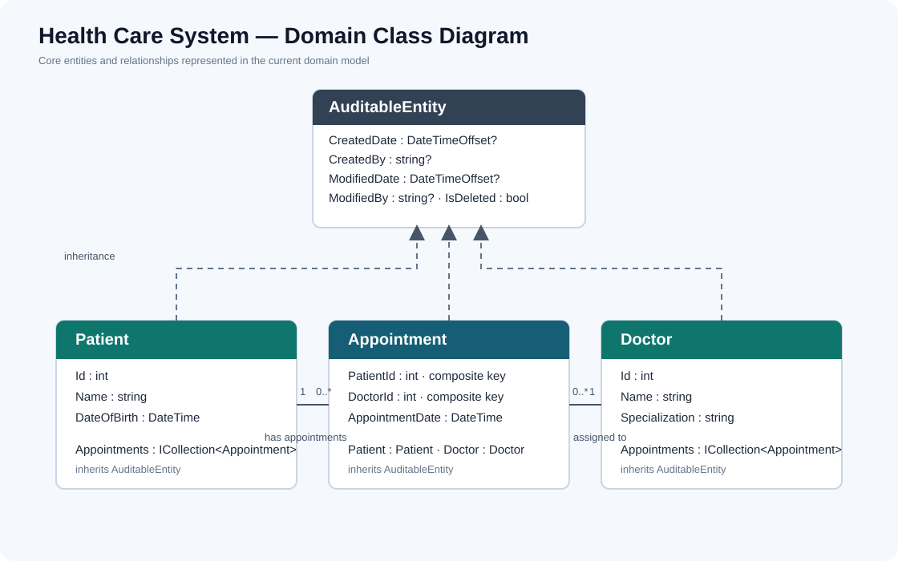

# Health Care System API

A healthcare management REST API built with ASP.NET Core. It provides patient, doctor, and appointment management, with JWT authentication and role-based authorization for Admin, Doctor, Receptionist, and Patient users.
### Accounts
#### Admin: admin@gmail.com , Admin1234$
#### Patient: patient@gmail.com , Patient1234$
#### Doctor: doctor@gmail.com , Doctor1234$
#### Receptionist: receptionist@gmail.com , Receptionist1234$

## Project overview

The solution is organized into three projects:

| Project | Responsibility |
| --- | --- |
| `Health_Care_System.API` | HTTP controllers, DTOs, validation boundary, authentication setup, dependency injection, and application services |
| `Health_Care_System.Domain` | Core entities, role names, result types, pagination, and repository contracts |
| `Health_Care_System.Infrastructure` | EF Core contexts, entity configurations, migrations, repositories, interceptors, and seeders |

The API follows a layered architecture. Controllers handle HTTP concerns, services implement application workflows, repositories handle data access, and the Domain project holds the core model and abstractions.

## Architecture

### Layer responsibilities

- **API:** Exposes REST endpoints, accepts DTOs, applies authorization rules, and maps service results to HTTP responses.
- **Services:** Coordinates workflows such as creating patients, scheduling appointments, registering users, and generating JWTs.
- **Domain:** Defines `Patient`, `Doctor`, `Appointment`, `ApplicationUser`, shared audit fields, role constants, result types, and repository interfaces.
- **Infrastructure:** Implements persistence with Entity Framework Core and SQL Server, including repositories, mappings, migrations, and seed data.

### Patterns and conventions

- **Repository pattern:** Service logic depends on repository interfaces; EF Core implementations live in Infrastructure.
- **DTOs:** API requests and responses are separate from persistence entities.
- **Result pattern:** Services return `Result` or `GenericResult<T>` to represent success or failure; controllers translate failures to HTTP responses.
- **AutoMapper:** Mapping profiles are registered for patient, doctor, and appointment DTOs.
- **Dependency injection:** Database contexts, repositories, services, Identity, and JWT authentication are registered at application startup.

## Project structure

```text
Health Care System/
├── Diagrams/
│   ├── class-diagram.svg
│   ├── DB Diagram.png
│   └── Health Care System .drawio.png
├── Health_Care_System.API/
│   ├── Controllers/
│   ├── DTOs/
│   │   ├── Account/
│   │   ├── Appointments/
│   │   ├── Doctors/
│   │   ├── Mapping/
│   │   └── Patients/
│   ├── Errors/
│   ├── Extensions/
│   ├── Middlewares/
│   ├── Services/
│   │   ├── Implementations/
│   │   └── Interfaces/
│   ├── Program.cs
│   └── appsettings.json
├── Health_Care_System.Domain/
│   ├── Entities/
│   │   ├── Common/
│   │   └── Identity/
│   └── Repositories/
└── Health_Care_System.Infrastructure/
    └── Persistence/
        ├── Configurations/
        ├── Interceptors/
        ├── Migrations/
        ├── Repositories/
        └── Seeding/
```

## Domain model

The class diagram below reflects the current Domain entities. `Appointment` has a composite key made from `PatientId` and `DoctorId`; both it and the Patient and Doctor entities inherit shared audit fields from `AuditableEntity`.



### Core entities

- **Patient:** Name, date of birth, and appointments.
- **Doctor:** Name, specialization, and appointments.
- **Appointment:** Patient/doctor relationship and appointment date. Its key is composite (`PatientId`, `DoctorId`).
- **AuditableEntity:** Shared created/modified metadata and `IsDeleted` flag.
- **ApplicationUser:** ASP.NET Core Identity account with a `FullName` field. User accounts and application patients are separate models.

## Main features

### Patient, doctor, and appointment management

The API provides create, read, update, and delete operations for core healthcare records. Services return paginated results for patient and doctor lists where supported.

### Authentication and role assignment

- Public registration creates an Identity account and automatically assigns the `Patient` role. The public registration DTO has no `Role` field.
- Login returns the account's assigned role and a JWT containing role claims.
- Admin-only `create-user` lets an Admin create accounts with one of the seeded system roles: `Admin`, `Doctor`, `Receptionist`, or `Patient`.
- Role assignment is checked against both the allowed role names and roles present in Identity.

### Persistence and auditing

- `HealthCareContext` stores healthcare entities.
- `AuthenticationContext` stores ASP.NET Core Identity users and roles.
- EF Core migrations are kept under `Infrastructure/Persistence/Migrations`.
- SaveChanges interceptors stamp creation/modification timestamps and convert deletes of `AuditableEntity` records into soft deletes.

### Seeding

On startup, the application applies migrations and seeds healthcare sample data and the system roles. An optional bootstrap Admin can be created using environment configuration;

## Authorization rules

The current controller attributes define these role rules:

| Resource/action | Allowed roles |
| --- | --- |
| List or view doctors | Admin, Doctor, Receptionist, Patient |
| Create, update, or delete doctors | Admin |
| List or view patients | Admin, Doctor, Receptionist |
| Create, update, or delete patients | Admin, Receptionist |
| List or view appointments | Admin, Doctor, Receptionist |
| Create appointments | Admin, Receptionist, Patient |
| Update or delete appointments | Admin, Receptionist |
| Create Identity users with a selected role | Admin |
| Register and login | Public endpoints |

The current API does not yet enforce patient ownership when reading or changing an individual appointment. Patient users can create appointments, but cannot use appointment read/update/delete endpoints.

## API endpoints

Base route: `/api`

| Method | Route | Description |
| --- | --- | --- |
| `POST` | `/Auth/register` | Public Patient registration |
| `POST` | `/Auth/login` | Login and receive JWT |
| `POST` | `/Auth/create-user` | Admin creates a user with a selected role |
| `GET` | `/Doctor` | List doctors |
| `GET` | `/Doctor/{id}` | Get doctor details |
| `POST` | `/Doctor` | Create doctor (Admin) |
| `PUT` | `/Doctor/{id}` | Update doctor (Admin) |
| `DELETE` | `/Doctor/{id}` | Delete doctor (Admin; soft delete through interceptor) |
| `GET` | `/Patient?pageNumber=1&pageSize=10` | List patients |
| `GET` | `/Patient/{id}` | Get patient details |
| `POST` | `/Patient` | Create patient (Admin or Receptionist) |
| `PUT` | `/Patient/{id}` | Update patient (Admin or Receptionist) |
| `DELETE` | `/Patient/{id}` | Delete patient (Admin or Receptionist; soft delete through interceptor) |
| `GET` | `/Appointments` | List appointments |
| `GET` | `/Appointments/{patientId}/{doctorId}` | Get appointment by composite key |
| `POST` | `/Appointments` | Create appointment |
| `PUT` | `/Appointments/{patientId}/{doctorId}` | Update appointment (Admin or Receptionist) |
| `DELETE` | `/Appointments/{patientId}/{doctorId}` | Delete appointment (Admin or Receptionist; soft delete through interceptor) |

Swagger UI is enabled in the Development environment. Use **Authorize** and provide a JWT to call protected endpoints.

## Request pipeline

The API configures HTTPS redirection, JWT authentication, authorization, and controller routing. Three custom middleware components are present:

- `ExceptionHandlingMiddleware` formats unhandled errors as Problem Details.
- `RequestIdHeaderMiddleware` adds a `Request-Id` response header and logs the request ID.
- `RequestTimingMiddleware` logs request duration and outcome.

**Current status:** These three middleware calls are commented out in `Program.cs`, so they are implemented but are not active in the running request pipeline. The EF Core interceptors are active through `AddDatabaseServices`.

Do not commit production secrets. Use .NET user secrets or deployment environment variables for connection strings and JWT keys.

### Optional initial Admin

To create the first Admin during startup, set these environment variables before running the API:

```text
BootstrapAdmin__Email
BootstrapAdmin__Password
BootstrapAdmin__FullName
```

The account is created only when the configured email is not already registered. If the email exists, the seeder does not change the account or its roles. The bootstrap password must satisfy the configured ASP.NET Core Identity password rules.

## Run the project

```powershell
dotnet restore
dotnet run --project .\Health_Care_System.API\Health_Care_System.API.csproj
```

In Development, open the Swagger URL printed in the console. The application migrates and seeds the database during startup.

### Try the authentication flow

1. Register a user at `POST /api/Auth/register`; the resulting role is `Patient`.
2. Log in at `POST /api/Auth/login` and copy the returned JWT.
3. Use an Admin JWT with Swagger's **Authorize** button.
4. Create a Doctor or Receptionist using `POST /api/Auth/create-user`.
5. Try the same protected endpoint without a token (`401`), then with a non-Admin JWT (`403`).

## Notes

- Healthcare records and Identity accounts use separate EF Core contexts and connection-string entries.
- `Patient` business records are not automatically created as part of Identity registration in the current implementation.
- Deleting an `AuditableEntity` is stored as a soft delete. The repository's `GetByIdAsync` excludes deleted rows, but its paginated `GetAllAsync` currently does not filter them out.
- The repository contains an older diagram image under `Diagrams/`; `class-diagram.svg` is the corrected class diagram for the current entities.
